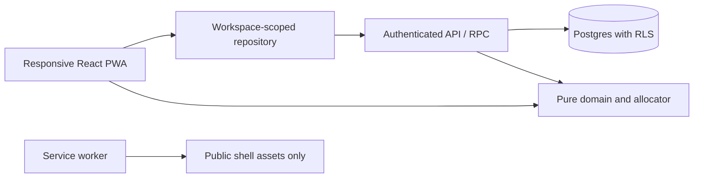

> **Architecture status:** Detailed financial, authorization and public-only PWA contracts below remain supporting requirements. The [approved PRD](02-PRD.md) governs product decisions and the [roadmap](../../ROADMAP.md) governs phases. Preserve the existing Vite/React app. Vercel/Supabase are proposals; backend execution and session architecture require an ADR before implementation. The SQL allocator execution choice below is a proposal, not a final decision. Secure persistent sessions are required; the memory-only refresh/sign-in proposal below is superseded. No financial/token persistence in public PWA caches is permitted.

# Technical architecture

Status: Vite/React web foundation implemented; backend and execution architecture proposed, not deployed. Preserve domain rules from the audited algorithm/schema.

## Architecture decision

Use React + TypeScript with Vite, a browser router and semantic HTML/CSS for the client; proposed Supabase Auth/Postgres for identity and durable data; database transactions/functions for financial commands; static HTTPS hosting with SPA fallback for the client. Select compatible versions at implementation time and record exact versions and lockfile. These are design choices, not claims about the latest library releases or existing installed services.

Historical rationale: the original audit found no remote app, while local React Native components were an uncommitted prototype. The web foundation now exists and must be preserved. A browser client gives direct control of desktop layout, forms, keyboard interaction, manifest and service-worker behavior. Preserve pure TypeScript helpers and product contracts; port visual components instead of carrying a native presentation dependency into the web product. Native clients can later share the domain package, not dictate this release.

Do not adopt a second competing web framework. If the implementation checkout has changed materially, inspect it, record an ADR and reuse a sound web implementation. Keep the local Expo prototype intact until salvage is verified.



Domain modules have no React, browser storage, network, random or wall-clock dependencies. UI receives view models, never performs independent financial arithmetic. Server recomputes acceptance against authoritative state; a client preview is untrusted.

## Suggested structure

```text
web/                       isolated web package during transition
  src/app/                 router, shell, workspace/session context
  src/components/          semantic accessible controls
  src/theme/               CSS semantic tokens and responsive layout
  src/features/            plan, activity, goals, household, learn
  src/domain/              money, dates, recurrence, allocator, contracts
  src/data/                repository contracts and mock/auth adapters
  src/fixtures/            synthetic records only
  src/content/             versioned curriculum and reviewed lessons
  public/                  manifest, icons and public offline page
  tests/                   domain and browser checks
supabase/migrations/       later phase only
docs/                      ADRs, plan, verification and release evidence
```

During migration root Expo scripts remain intact. The canonical app location is web/; preserve root prototype work.

## Domain and persistence contracts

Use branded Cents with safe integer boundaries. Parse decimal strings with exact arithmetic; checked sums/intermediate multiplication use BigInt. Database BIGINT values serialize as decimal strings at boundaries and convert only after safe-range validation. Versions also require checked integer semantics. Replace the demo-only WorkspaceId union with validated opaque IDs; fixture aliases stay within mock adapters.

Retain logical entities from the original schema: profiles, workspaces, memberships, invitations, accounts, categories, envelopes, transactions, income schedules, obligations/occurrences, goals, allocation settings, snapshots/events/accepted plans, lesson progress and audit events. Published lessons may be versioned static content; private progress stays server-side. A settings edit increments settings_version; any financial mutation increments ledger_version.

Account balances derive from opening balance plus posted entries; reservation balances derive from allocation events. Never expose independently writable balance totals. Goals reference one envelope. Composite (workspace_id, entity_id) foreign keys prevent cross-workspace references. Transfer legs are equal/opposite and commit together within one workspace. Forecast schedules never write posted income automatically. Recurrence expansion creates stable occurrence IDs and deduplicates them; paid/cancelled occurrences cannot be requested again. Date-only values use workspace-local calendar dates; UTC timestamps record events.

Repository methods require explicit workspace context, for example getSnapshot(workspaceId), listTransactions(workspaceId, filters), previewPlan(workspaceId, input), postTransaction(workspaceId, command), acceptPlan(workspaceId, command). Lesson progress uses user identity instead. Runtime validation applies at every untrusted boundary, not only TypeScript compilation.

Financial command envelope: authenticated actor from session, workspace ID, idempotency key, expected version, validated payload. Never trust a supplied actor ID. Response returns authoritative versions and result or typed errors: VALIDATION, FORBIDDEN, STALE_VERSION, RECONCILIATION_REQUIRED, IDEMPOTENCY_CONFLICT and RETRYABLE_FAILURE. Display actionable copy without exposing private object existence.

## Acceptance transaction

1. Authenticate and authorize owner/editor for the workspace; lock the workspace version row. All financial writers take this lock consistently.
2. Check idempotency key and payload hash. A matching committed retry returns the same result; a mismatched payload conflicts. Check this before rejecting a retry on an incremented version.
3. Validate ledger/settings/rule versions and period, fetch authoritative cash/reservations/demands, recompute deterministic preview and validate user edits/acknowledgments. Never trust client totals or hashes.
4. Insert accepted-plan record, allocation events and minimized audit metadata; increment ledger version in the same transaction. A unique workspace/key and unique accepted snapshot prevent double application.
5. Commit and return updated totals. Failure rolls everything back. A lost response is retried with the same key; a stale snapshot refreshes and needs user review.

Other writes use the same serialization/version discipline, including expenses, opening-balance corrections, refunds, goal targets and reserve releases. Acceptance cannot independently race a cash expense. Editing history uses reversal/void and replacement with audit rather than silent destructive updates.

Proposed execution boundary (requires technical review): TypeScript runs the interactive client preview. One option is an authoritative allocator inside the locked Postgres transaction as a versioned SQL/PLpgSQL implementation of the same rules. SQL must use exact intermediate arithmetic and the same canonical ordering, caps and rounding. Both implementations consume shared language-neutral fixtures and must produce equivalent normalized results before acceptance is enabled. Do not assume Postgres executes the TypeScript module, or compute outside the lock and then trust client totals. The diagram's Domain box describes the shared rule contract, not one runtime binary. If maintaining two implementations proves excessive, record an ADR for a server runtime that can run the shared TypeScript within a database transaction before building acceptance.

## Identity and household enforcement

RLS denies nonmembers and personal-workspace peers on all base tables. Owner/editor write; viewer read; owner alone manages membership. Privileged functions have fixed search paths and explicit authorization. Protect both old and new workspace IDs on updates. Enforce one personal owner and one active household per user in constraints/transactions. Never allow client role escalation.

Store invitation token hashes, expiration, recipient binding and used/revoked state. Acceptance validates authenticated recipient and membership limits atomically. Owner transfer changes workspace owner and membership together. Export uses the same scope. Test nested joins, direct IDs, RPCs, realtime subscriptions, revoked access and service-role bypass boundaries. Fixture isolation tests are not substitutes.

Secure persistent sessions are required, alongside email/password registration, email verification, password reset, logout and session revocation. The earlier memory-only session proposal (requiring sign-in after refresh) is superseded. Review the provider/runtime and session execution boundary before implementation; a same-origin session/BFF with HttpOnly Secure SameSite cookies and CSRF protection is one option, not a selected architecture. Do not silently add token localStorage persistence or a persisted financial query cache. A strict CSP, safe text rendering and minimized third-party scripts reduce browser exposure.

## PWA and offline contract

Manifest: stable ID, name/short name, start_url, scope, standalone display, light theme/background, 192/512 PNG icons and maskable variant. HTTPS is required for production service workers. Installation UI is capability-based: support browser prompt where available and contextual instructions otherwise; do not promise all browsers expose the same install control.

Service worker precaches versioned public shell assets and a public offline explanation. Authentication endpoints, APIs, RPCs, exports, authenticated navigation responses and financial payloads use network-only/no-store. No financial data or tokens in Cache Storage, IndexedDB or localStorage. Cache only an explicit allowlist of public static assets, never all successful GETs. Clear app state on sign-out, workspace switch, session expiry or detected revocation. Requests carry workspace/version and late responses from a prior workspace are discarded.

Offline: public shell/help may load; finances show “Connect to load your budget”; no queued financial writes. A connection can fail after a commit, so recovery uses idempotency rather than assuming failure. Updates show “Update available”; activate after confirmation and draft handling, then reload. Never force a service-worker reload during plan review. Browser installation is verified separately from manifest generation.

## Operations and quality

Foundation uses no hosted resources or credentials. Phase 0 configures web CI; the backend phase adds versioned migrations, local database tests and RLS/concurrency CI coverage. Production needs selected hosting/region, TLS, dependency review, content review, privacy/retention policy, scoped export/deletion, backup restore rehearsal and named support/incident owner. Proposed availability objective and alert thresholds must be set against budget before launch.

CI gates: clean install, typecheck, lint, domain invariants, browser journeys and build; later migration/RLS/concurrency suites. Test rounding/caps, pay boundaries, leap dates, duplicate IDs, refunds/transfers, negative cash, stale accepts and simultaneous writers. Browser tests cover desktop/mobile sizes, keyboard, deep links, workspace reset and PWA cache exclusions. Automated accessibility checks plus manual screen reader/zoom checks. No raw amounts, request bodies, tokens or transaction descriptions in analytics/logs.

## Current primary references

Checked October 27, 2026. These support platform capabilities; the architecture choices above remain proposals.

- [Vite static deployment](https://vite.dev/guide/static-deploy): production static output and hosting setup; configure deep-link fallback on the selected host.
- [Supabase row-level security](https://supabase.com/docs/guides/database/postgres/row-level-security): database access policies for exposed tables; workspace membership and revocation rules still require our implementation and tests.
- [MDN installability](https://developer.mozilla.org/en-US/docs/Web/Progressive_web_apps/Guides/Making_PWAs_installable): manifest and browser-specific installation behavior. A service worker supports the planned offline experience; it is not a universal installation prerequisite.
- [MDN caching](https://developer.mozilla.org/en-US/docs/Web/Progressive_web_apps/Guides/Caching): service-worker cache behavior. The public-only allowlist is our privacy policy, not a browser default.
